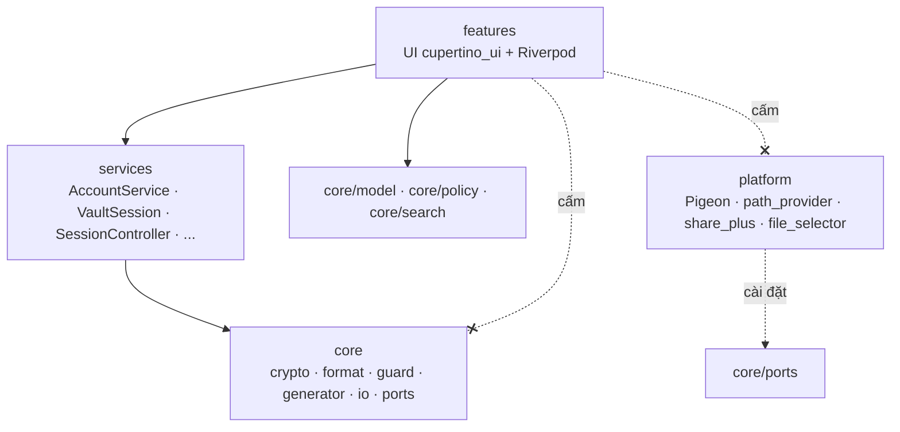
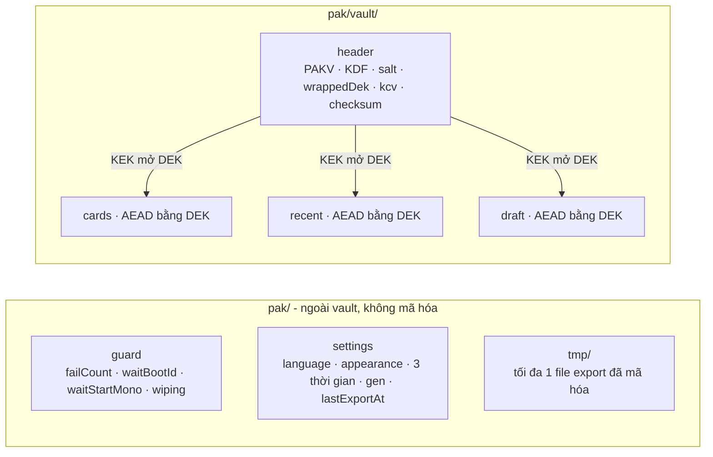
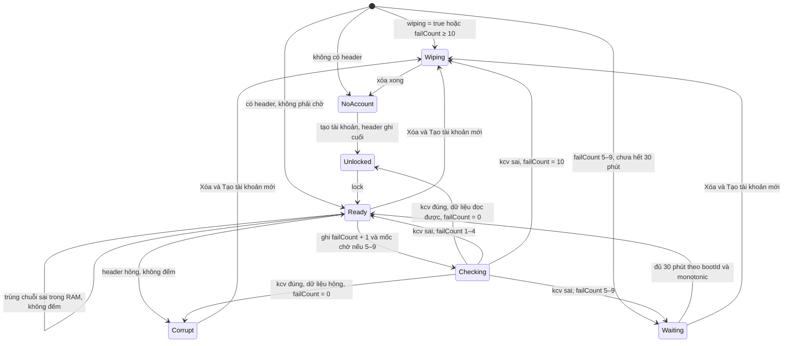
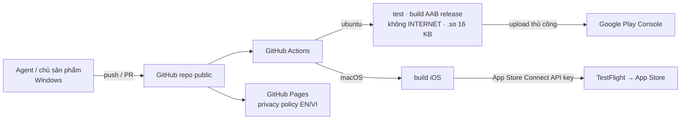

# Architecture Spine — PAK Manager

Mã FR-/NFR-/TC- dẫn tới `prd.md`; S1–S28 dẫn tới bảng surface trong `EXPERIENCE.md`. Lý do của từng quyết định nằm trong `.memlog.md` cùng thư mục; các review nằm trong `reviews/`.

## Design Paradigm

**Functional core / imperative shell**, phân lớp, phụ thuộc chỉ đi một chiều:

| Lớp | Thư mục | Chứa | Được phép |
| --- | --- | --- | --- |
| features | `lib/features/<luồng>/` | Widget `cupertino_ui`, Riverpod provider của màn hình | Gọi services; import `core/model`, `core/policy`, `core/search` |
| services | `lib/services/` | `AccountService`, `VaultSession`, `SessionController`, `LockoutGuard`, `WipeCoordinator`, `ClipboardService`, `GeneratorService`, `TransferService`, `SettingsStore` | Điều phối core + port; giữ trạng thái runtime |
| core | `lib/core/` | Model, crypto, codec định dạng, máy trạng thái guard, `PasswordPolicy`, generator, chuẩn hóa tìm kiếm, interface port, `AtomicFileWriter` | **Dart thuần**: không import `package:flutter` hay plugin. Chỉ `lib/core/io/` được import `dart:io` |
| platform | `lib/platform/` + `ios/` + `android/` | Cài đặt port: một API Pigeon, `path_provider`, `share_plus`, `file_selector` | Chỉ được gọi qua interface port trong `core/ports` |



## Invariants & Rules

### AD-1 — Một codebase Flutter, giao diện `cupertino_ui` trên cả hai nền tảng [ADOPTED]

- **Binds:** toàn app; NFR-12, NFR-13; UX "dáng iOS trên Android"
- **Prevents:** hai bản cài đặt định dạng vault/export lệch nhau (FR-61, FR-62); Material lẫn vào giao diện; code dựa trên thư viện Cupertino sắp bị deprecate trong SDK.
- **Rule:** Widget lấy từ `package:cupertino_ui/cupertino_ui.dart`. Cấm `package:flutter/cupertino.dart`, `package:flutter/material.dart` và `material_ui` trong `lib/` (lint import của AD-2 kiểm tra). Icon chỉ dùng `CupertinoIcons`, **kể cả trên iOS** (thay SF Symbols của DESIGN; chỗ glyph thiếu thì vẽ bằng `CustomPainter` trong `features/shared/icons/`, không thêm font icon). Font là font hệ thống. Điện thoại khóa hướng dọc; tablet cho mọi hướng, mọi màn hình nằm trong `ContentColumn` (căn giữa, rộng tối đa 672 pt, nền phủ toàn màn) và không giả định tỷ lệ màn hình cố định. `textScaler` bị kẹp ở mức tối đa 1,3 tại gốc app. Bố cục dùng safe-area inset, không dùng số đo cố định cho thanh hệ thống.

### AD-2 — Hướng phụ thuộc features → services → core

- **Binds:** mọi module trong `lib/`
- **Prevents:** màn hình tự đọc/ghi file, tự gọi crypto hoặc native; logic bảo mật bị nhân bản ở UI.
- **Rule:** Theo bảng và sơ đồ ở Design Paradigm. `lib/features/` chỉ được import từ core các thư mục `core/model`, `core/policy`, `core/search`; không import `core/crypto`, `core/format`, `core/io`, `core/ports`, `lib/platform/` hay `dart:io`. `lib/core/` không import `package:flutter` hay plugin. Native chỉ được gọi qua port. CI chạy `tool/check_imports.dart` (script Dart, không thêm dependency) và fail khi vi phạm luật này hoặc luật import của AD-1.

### AD-3 — `VaultSession`: một instance cho mỗi lần đăng nhập, chủ duy nhất của khóa và dữ liệu giải mã

- **Binds:** F1, F2, F4, F6; NFR-1, NFR-4; FR-26
- **Prevents:** hai nơi cùng giữ DEK hoặc bản rõ; lệnh ghi cũ chạy sau khi khóa hoặc xóa; mất bản nháp khi khóa.
- **Rule:**
  - Mỗi lần mở khóa thành công, `AccountService` (AD-26) tạo **một instance `VaultSession` mới**. Features lấy instance qua provider phiên (AD-23). Sau `lock()`, instance vô hiệu vĩnh viễn: mọi method trả `locked` và không làm I/O.
  - Chỉ `VaultSession` giữ DEK (`SecureKey` của libsodium), giữ model giải mã (card, Recent, bản nháp, payload import đang chờ xác nhận) và đọc/ghi thư mục `vault/`. Mọi thay đổi dữ liệu (card, Recent, bản nháp, import, đổi mật khẩu chính) là một method của `VaultSession`. Nơi khác chỉ nhận bản đọc bất biến.
  - Mọi I/O của phiên đi qua **một hàng đợi tuần tự**.
  - Bản nháp: features gọi `updateDraft(d)` mỗi lần đổi; debounce ≤ 500 ms nằm **trong `VaultSession`**. `lock()` flush bản nháp đang chờ trước khi hủy `SecureKey`; lần flush này được tính là thao tác ghi đang chạy theo FR-16. Widget không bao giờ ghi bản nháp trong `dispose()`.

### AD-4 — Khóa hai tầng, `checksum` và `kcv` tách sai mật khẩu khỏi dữ liệu hỏng

- **Binds:** FR-1, FR-5, FR-7, FR-13, FR-51; NFR-1, NFR-2
- **Prevents:** đổi mật khẩu chính phải mã hóa lại vault; header hỏng bị tính là sai mật khẩu rồi dẫn tới tự xóa (FR-7, TC-6).
- **Rule:** DEK = 32 byte ngẫu nhiên, sinh một lần khi tạo tài khoản. KEK = Argon2id(mật khẩu, salt). Layout header ở AD-20.
  - `checksum` = BLAKE2b-256 không khóa trên mọi byte đứng trước nó. Không phụ thuộc mật khẩu.
  - `kcv` = BLAKE2b 16 byte, khóa = KEK, thông điệp `PAK-KCV-v1`.
  - Thứ tự mở khóa:
    1. Đọc header. Sai kích thước, sai magic/version, `checksum` lệch hoặc tham số ngoài khoảng của AD-5 → **`corrupt`**, không chạm `LockoutGuard`, không chạy KDF.
    2. `LockoutGuard` ghi trước (AD-8), rồi chạy KDF ra KEK.
    3. So `kcv` bằng phép so hằng thời gian. Lệch → **`wrongPassword`**.
    4. Khớp → mật khẩu đúng: `LockoutGuard.recordSuccess()` (failCount = 0) **trước** mọi bước sau. Mở bọc DEK hoặc giải mã file dữ liệu lỗi → **`corrupt`**.
  - Đổi mật khẩu chính tính lại salt, tham số, `wrapNonce`, `wrappedDek`, `kcv`, `checksum` trong **một** lần ghi `header`. Kiểm tra lại mật khẩu ở FR-13 và FR-51 dùng bước 1, 3 và 4, bỏ phần `LockoutGuard`.

### AD-5 — Tham số và cách chạy Argon2id

- **Binds:** NFR-2, NFR-3, FR-54, FR-63
- **Prevents:** file export không mở được trên máy khác; file độc hại làm treo app; UI đứng hình khi chạy KDF.
- **Rule:** Khởi tạo libsodium bằng `SodiumSumoInit.init()` (`package:sodium/sodium_sumo.dart`). KDF dùng `pwhash.callRaw` với Argon2id13, **p=1 cố định** (libsodium không hỗ trợ p khác).
  - Vault: hiệu chỉnh trên máy lúc tạo tài khoản và lúc đổi mật khẩu chính. Khởi điểm m=64 MiB, t=3; mục tiêu ~1 giây; trần 2 giây; sàn m=19 MiB, t=2.
  - Export: **cố định** m=64 MiB, t=3.
  - Khi đọc header (vault hay export), tham số ngoài khoảng [m 19–128 MiB, t 2–10] bị từ chối **trước khi** chạy KDF.
  - KDF và lần chạy hiệu chỉnh luôn chạy ngoài UI isolate (`Sodium.runIsolated`). Kết quả trả về là `SecureKey`.

### AD-6 — Dữ liệu nằm trong vài file mã hóa nguyên khối

- **Binds:** F2, F4, FR-26; NFR-1, NFR-5, TC-1
- **Prevents:** dữ liệu người dùng rơi ra ngoài vault; tráo file giữa các loại; hai cách hiểu về file bị thiếu.
- **Rule:**
  - `vault/` gồm `header`, `cards`, `recent`, `draft`. Mỗi file dữ liệu là JSON (schema ở AD-20), được mã hóa XChaCha20-Poly1305 bằng DEK, nonce ngẫu nhiên mỗi lần ghi, associated data `PAK-VAULT/<loại>/v<N>`.
  - Mở khóa thì giải mã toàn bộ vào RAM. Tìm kiếm chạy trong RAM, không có chỉ mục trên đĩa.
  - Có `header` mà thiếu `cards` hoặc `recent` → `corrupt`. Thiếu `draft` nghĩa là không có bản nháp.
  - Tiêu đề, tên đăng nhập, mật khẩu, Note, Recent và bản nháp **chỉ** được ghi xuống đĩa bên trong các file này.

### AD-7 — Ghi nguyên tử, mỗi thao tác commit một file

- **Binds:** NFR-11, FR-12, FR-16, FR-26, FR-59, TC-6
- **Prevents:** vault hỏng khi tắt đột ngột; tài khoản tạo dở; card trùng khi crash giữa Lưu và xóa bản nháp; ghi muộn tạo lại thư mục đã xóa.
- **Rule:**
  - Mọi lần ghi file (vault, guard, settings, export) đi qua `core/io/AtomicFileWriter`: ghi `<tên>.tmp` **cùng thư mục** với file đích → fsync file → rename đè → `FileSyncPort.fsyncDirectory`. Writer **không bao giờ tạo thư mục cha**; thư mục không tồn tại thì trả lỗi. Khởi động: xóa mọi `*.tmp` còn sót.
  - Mỗi thao tác nghiệp vụ commit đúng **một** file dữ liệu. Bước dọn dẹp đi sau phải idempotent.
  - Tạo tài khoản: dọn sạch `vault/` → tạo thư mục → ghi `cards` và `recent` rỗng → ghi `header` **cuối cùng**. Header là điểm commit.
  - Lưu card: **upsert theo `draft.cardId`** vào `cards`, sau đó xóa `draft`.
  - Lúc mở khóa, bản nháp bị bỏ không hỏi (không hiện S6) nếu:
    - `mode=create` mà `cardId` đã có trong `cards`;
    - `mode=edit` mà `cardId` không còn trong `cards`.

### AD-8 — `LockoutGuard`: bộ đếm sai bền vững, fail-closed, không phụ thuộc đồng hồ máy

- **Binds:** FR-4, FR-5, FR-6, FR-8, TC-3
- **Prevents:** tắt app giữa lúc kiểm tra để né thời gian chờ hoặc né lần xóa thứ 10; chỉnh đồng hồ hoặc khởi động lại để rút ngắn thời gian chờ; thời gian chờ vô hạn; lộ chuỗi gần đúng ra đĩa.
- **Rule:** Chỉ `LockoutGuard` đọc/ghi `guard` (schema AD-20). File này không mã hóa. Rủi ro chấp nhận: root/jailbreak sửa được file, lớp bảo vệ thật là KDF. Máy trạng thái thuần nằm trong `core/guard`. Mỗi lúc chỉ một lần kiểm tra.
  - **Trước KDF, một lần ghi:** `failCount += 1`. Nếu giá trị mới nằm trong 5–9 thì đặt luôn mốc chờ bằng `(bootId, monotonicMs)` hiện tại. Ghi lỗi → hủy lần thử, không chạy KDF.
  - **Mật khẩu đúng** (kể cả khi sau đó ra `corrupt`): một lần ghi `failCount = 0` và xóa mốc chờ.
  - **Chuẩn hóa khi khởi động**, theo thứ tự, mỗi lần đặt lại đều ghi xuống ngay rồi mới hiển thị:
    1. `wiping = true` hoặc `failCount ≥ 10` → `WipeCoordinator` (AD-21).
    2. `failCount` 5–9 mà không có mốc chờ → mốc = bây giờ.
    3. `waitBootId` khác `bootId` hiện tại, hoặc `monotonicMs` < mốc → mốc = bây giờ. Thời gian chờ không bao giờ bị rút ngắn.
  - Có `header` mà `guard` thiếu hoặc không đọc được → tạo lại với `failCount = 0` (cùng lớp rủi ro chấp nhận ở trên).
  - Chuỗi sai lần trước chỉ giữ trong RAM dưới dạng digest có khóa (AD-22). Trùng digest thì báo sai ngay, không đếm, không chạy KDF.
  - Ba hằng số 10 lần / từ lần thứ 5 / 30 phút nằm trong code, không có cài đặt.

### AD-9 — `SessionController` là nguồn duy nhất quyết định khóa app

- **Binds:** FR-14, FR-15, FR-16, FR-49, FR-65; NFR-4
- **Prevents:** nhiều timer khóa chạy song song; autolock không chạy sau khi máy ngủ trên iOS; khóa giữa lúc đang ghi; kết quả từ UI hệ thống rơi vào phiên đã khóa.
- **Rule:**
  - Chỉ `SessionController` giữ hạn phiên tuyệt đối và autolock, và gọi `lock()`.
  - **Mọi hạn thời gian** (phiên, autolock, Clear Clipboard, thời gian chờ guard) tính bằng `ClockPort.monotonicMs`, đồng hồ tính cả lúc máy ngủ. `Stopwatch` và `DateTime.now()` không bao giờ là nguồn sự thật; `Timer` chỉ dùng để đánh thức lần kiểm tra.
  - "Vào nền" = lần đầu nhận `AppLifecycleState.hidden` (hoặc `paused` nếu không có `hidden`) sau `resumed`. `inactive` không tính.
  - Khi `resumed`: (1) `ClipboardService.onResume()` → (2) `SessionController.evaluate()`. Khóa phát hiện ở bước (2) tính là khóa ở tiền cảnh.
  - Trình tự khóa:
    1. Flush bản nháp.
    2. Chờ thao tác ghi đang chạy xong hoặc hoàn tác (FR-16).
    3. Hủy thao tác chưa ghi.
    4. `VaultSession.lock()`.
    5. Nếu khóa ở tiền cảnh thì `ClipboardService.clearIfOurs()`.
    6. Tăng epoch phiên; AD-23 thay toàn bộ cây UI sau đăng nhập bằng S3.
  - Mọi `await` trên port của platform (chọn file, share) phải so epoch sau khi trả về; epoch đã đổi thì bỏ kết quả.
  - Đổi cài đặt thời gian có hiệu lực từ lần đếm kế tiếp.
  - OS kill process = khóa (giới hạn chấp nhận). Không dùng state restoration.

### AD-10 — Định dạng file export là hợp đồng vĩnh viễn

- **Binds:** F6, FR-53–FR-63, NFR-3, TC-2, TC-5
- **Prevents:** file tạo ở phiên bản hoặc nền tảng này không import được ở phiên bản hoặc nền tảng khác; import ghi một phần; file độc hại làm cạn bộ nhớ.
- **Rule:**
  - Một codec duy nhất: `core/format/export/`. Layout và payload ở AD-20.
  - Import theo thứ tự:
    1. File > 8 MiB, sai magic/version hoặc tham số ngoài khoảng → "File không hợp lệ".
    2. Chạy KDF (AD-5).
    3. AEAD lỗi → sai mật khẩu export (thử lại không giới hạn).
    4. Payload phải đúng schema, ≤ 10 000 card, mỗi card có `title`/`username`/`password` không rỗng, mỗi chuỗi ≤ 64 KiB, `createdAt` ≥ 0. Chỉ một card sai cũng từ chối cả file.
    5. Payload chuyển cho `VaultSession.stageImport()` để hiện xem trước (S26).
    6. Xác nhận → một lần ghi `cards`, cấp id mới, giữ `createdAt` gốc.
  - Phiên bản định dạng đã phát hành không bao giờ bị sửa. Thay đổi = phiên bản mới, kèm reader cho mọi phiên bản cũ.
  - Mỗi phiên bản có file mẫu `test/fixtures/export/v<N>.pakx`, **sinh từ bảng AD-20 bằng script trong `tool/`** (dữ liệu giả, không dùng code app). CI bắt buộc import được mọi file mẫu.

### AD-11 — Một thư mục gốc, một cầu nối native qua Pigeon, không dùng Keychain/Keystore

- **Binds:** FR-6, FR-11, FR-65, NFR-8, NFR-9
- **Prevents:** native code rải rác; file mới tạo bằng rename mất cờ loại khỏi backup (NFR-8); dữ liệu sót lại sau khi gỡ app trên iOS.
- **Rule:**
  - Mọi file của app nằm dưới `ApplicationSupport/pak/`, gồm `vault/`, `guard`, `settings` và `tmp/`.
  - iOS: đặt `isExcludedFromBackup` trên **thư mục `pak/`**, đặt lại ở mỗi lần khởi động trước mọi I/O. Android: `allowBackup=false`; `dataExtractionRules` loại trừ mọi domain cho cả `cloud-backup` và `device-transfer`; `fullBackupContent` tương ứng.
  - Code native tự viết nằm trong **một** API Pigeon (`pigeons/platform_api.dart`, `@HostApi` đồng bộ, kênh mặc định, không bật FFI/JNI thử nghiệm). Đúng bốn nhóm:
    - **đồng hồ:** `bootId` dạng chuỗi (Android `Settings.Global.BOOT_COUNT`, iOS `kern.bootsessionuuid`) và `monotonicMs` (Android `elapsedRealtime`, iOS `mach_continuous_time`);
    - **clipboard:** AD-17;
    - **backup:** đặt cờ loại trừ;
    - **`fsyncDirectory`.**
  - Thêm nhóm = sửa AD này. iOS đăng ký API trong `FlutterImplicitEngineDelegate` (UIScene). Không dùng API "required reason" của Apple nếu chưa khai báo trong privacy manifest.
  - Share sheet và chọn file dùng `share_plus` / `file_selector` sau port. Không ghi gì vào Keychain/Keystore.

### AD-12 — Không có mạng, theo chính sách dependency

- **Binds:** NFR-7, TC-4
- **Prevents:** một dependency kéo theo network I/O, analytics hoặc quyền `INTERNET`.
- **Rule:**
  - Mọi dependency trong `pubspec.yaml`, kể cả `dev_dependencies`, phải có trong bảng Stack. Thêm dependency = cập nhật spine, kèm ghi chú đã rà soát network code.
  - Lint dùng rule khai báo trực tiếp trong `analysis_options.yaml`; test dùng `flutter_test` của SDK và fake tự viết, không dùng thư viện mock.
  - Cấm `HttpClient`/`Socket` của `dart:io`, `package:http`, SDK analytics, crash reporting và quảng cáo.
  - CI build release Android và fail nếu manifest đã merge có `android.permission.INTERNET`. iOS: rà soát theo bảng Stack, bắt gói tin trước mỗi lần phát hành (AD-24).

### AD-13 — Ngoài vault chỉ có `guard`, `settings` và `tmp/`

- **Binds:** TC-1, NFR-1, NFR-8, FR-35, FR-47, FR-50, FR-55, FR-56
- **Prevents:** một tính năng lén lưu dữ liệu người dùng ra file không mã hóa; nhiều nơi cùng ghi `settings` làm mất cập nhật; file export tạm nằm lại mãi.
- **Rule:**
  - Ngoài `vault/`, app chỉ ghi `guard` (AD-8), `settings` và `pak/tmp/`.
  - `pak/tmp/` chỉ chứa **một** file export đã mã hóa đang chờ chia sẻ. File bị xóa khi share sheet đóng, ở mỗi lần khởi động và khi xóa dữ liệu. File do trình chọn file copy vào cache bị xóa ngay sau khi đọc.
  - Chỉ `SettingsStore` đọc/ghi `settings`. Store giữ một bản trong RAM làm nguồn sự thật và ghi toàn bộ snapshot qua hàng đợi tuần tự, gom thay đổi trong 300 ms. `settings` chứa **đúng** các trường ở AD-20.
  - Trường thiếu hoặc sai thì dùng mặc định của riêng trường đó. File không đọc được thì dùng toàn bộ mặc định; không bao giờ chặn Login.
  - Store được nạp **trước frame đầu tiên**.

### AD-14 — Ô nhập bí mật và hiển thị bí mật dùng widget chung

- **Binds:** FR-2, FR-52, FR-64, NFR-9
- **Prevents:** một màn hình quên tắt autofill hoặc tắt học từ bàn phím, hoặc cho bôi chọn mật khẩu.
- **Rule:** Mọi ô nhập mật khẩu (chính, export, mật khẩu card) dùng `SecretField`; mọi chỗ hiển thị mật khẩu hoặc Note dùng `SecretText`. Cả hai nằm trong `lib/features/shared/`.
  - `SecretField` cố định:
    - không autofill hints;
    - `autocorrect=false`, `enableSuggestions=false`, `enableIMEPersonalizedLearning=false` (cờ này chỉ có tác dụng trên Android);
    - không có menu Copy/Cut, vẫn cho Dán;
    - `controller.clear()` trong `dispose()`.
  - Ô mật khẩu chính và export giữ nguyên ký tự không ASCII khi gõ và báo lỗi qua `PasswordPolicy`.
  - `SecretText` không cho chọn, không cho kéo thả.
  - Không dùng `CupertinoTextField` trực tiếp cho bí mật. Nếu tắt đề nghị lưu mật khẩu của iOS cần native thì phải sửa AD-11.

### AD-15 — Luật mật khẩu chính/export nằm ở một chỗ

- **Binds:** FR-2, FR-3, FR-13, FR-52
- **Prevents:** ba màn hình (tạo tài khoản, đổi mật khẩu, export) kiểm tra theo ba kiểu khác nhau.
- **Rule:**
  - `core/policy/PasswordPolicy` là nơi duy nhất kiểm tra: ASCII in được, 15–128 ký tự, blocklist, lặp hoặc tuần tự. Lỗi trả về theo thứ tự ưu tiên: không ASCII → độ dài → phổ biến → lặp/tuần tự.
  - Login (S3) và Import (S25) cũng chặn nút khi chuỗi không ASCII hoặc ngắn hơn 15 ký tự. Chuỗi như vậy không bao giờ tới `LockoutGuard`.
  - Độ mạnh FR-2 dùng `zxcvbnm`: điểm 0–2 = Low, 3 = Medium, 4 = High.
  - Blocklist:
    - Nguồn SecLists. Chỉ giữ chuỗi ASCII in được dài 15–128, chuyển chữ thường. So khớp trên bản chữ thường.
    - Đóng gói thành Bloom filter (≤ 2 MB, dương tính giả ≤ 0,1%) ở `assets/blocklist.bloom`. Đặc tả định dạng (hàm băm, seed) ở `assets/blocklist.FORMAT.md`.
    - Script tạo nằm trong `tool/blocklist/`.

### AD-16 — Ngẫu nhiên chỉ từ CSPRNG, sinh mật khẩu không thiên lệch

- **Binds:** FR-29–FR-32, FR-34, NFR-6
- **Prevents:** dùng `Random()` thường; phân bố ký tự bị lệch do phép modulo.
- **Rule:**
  - DEK, salt, nonce, id và mật khẩu tạo ra đều lấy từ `randombytes` của libsodium qua một `RandomSource` trong core. Cấm `Random` của `dart:math`.
  - Generator dùng rejection sampling và bảo đảm mỗi loại ký tự đang bật có ít nhất một ký tự (FR-32), rồi xáo Fisher–Yates bằng cùng nguồn ngẫu nhiên.
  - Độ mạnh FR-34 = độ dài × log₂(kích thước bộ ký tự đang bật), tính trong core.

### AD-17 — Clipboard chỉ qua `ClipboardService`

- **Binds:** F7, FR-12, FR-38, FR-64, FR-65
- **Prevents:** một nút Copy ghi clipboard trực tiếp, bỏ qua hạn tự xóa; xóa nhầm thứ người dùng copy sau đó; Android 12+ hiện thông báo "đã dán từ clipboard" khi app kiểm tra.
- **Rule:**
  - Mọi Copy gọi `ClipboardService.copy(value)`. Không dùng `Clipboard.setData` ở nơi khác.
  - Service không giữ bản rõ. Nó chỉ giữ digest có khóa (AD-22), nhãn nonce của lần copy và hạn tính bằng `ClockPort`.
  - iOS: hạn tự hết + `localOnly`; kiểm tra bằng `changeCount`.
  - Android:
    - Nhãn `ClipDescription` = nonce. Từ API 33 gắn `EXTRA_IS_SENSITIVE`.
    - Kiểm tra bằng `getPrimaryClipDescription()`, không đọc nội dung clip.
    - Xóa bằng `clearPrimaryClip` (API ≥ 28) hoặc clip rỗng (API 24–27).
  - Khi app ở tiền cảnh, một timer đánh thức việc xóa lúc tới hạn.
  - Copy ở S14 còn gọi `VaultSession.recordRecent` (FR-38, FR-39). Các Copy khác không đụng Recent.
  - **Rủi ro chấp nhận:** Android 7–12 không có cơ chế hệ thống tự xóa clipboard. Nếu người dùng không quay lại app, giá trị có thể nằm trong clipboard vô thời hạn. Xóa dữ liệu chạy ở process mới thì không xóa được clipboard trên Android.

### AD-18 — Repo public: không secret, không dữ liệu thật, không log bí mật

- **Binds:** toàn repo, CI
- **Prevents:** lộ khóa ký app hoặc dữ liệu thật qua repo public; bản rõ lọt vào log qua exception.
- **Rule:**
  - Khóa ký Android, chứng chỉ iOS và API key chỉ nằm trong GitHub Secrets, và chỉ có trên workflow của `main`/tag.
  - Fixture và test chỉ dùng dữ liệu giả.
  - Không log mật khẩu, nội dung card, Recent, bản nháp hay khóa ở bất kỳ build nào.
  - Codec trong core bắt mọi exception và trả `corrupt`, không kèm thông điệp.
  - Bản release: `debugPrint` không làm gì; `FlutterError.onError` và `PlatformDispatcher.instance.onError` nuốt lỗi, không in ra.
  - Lint cấm `print(` trong `lib/`.

### AD-19 — Build và phát hành qua GitHub Actions

- **Binds:** vận hành, phát hành, NFR-7, TC-4
- **Prevents:** không build được iOS (không có Mac); kiểm tra NFR-7, 16 KB và tương thích file bị bỏ qua; build dev ghi đè vault thật.
- **Rule:**
  - GitHub Actions là môi trường build duy nhất cho release và cho Android. Build Android local trên Windows không được hỗ trợ.
  - App ID `io.github.truongthanhnam.pakmanager`. Flavor `dev` thêm hậu tố `.dev`.
  - Phiên bản: semver `MAJOR.MINOR.PATCH`; build number = số lần chạy CI.
  - Mỗi PR:
    - phân tích tĩnh + `tool/check_imports.dart` (AD-1, AD-2);
    - kiểm tra code Pigeon sinh ra đã cập nhật;
    - unit + widget test, import mọi file mẫu (AD-10, AD-25);
    - build release Android, kiểm tra không có `INTERNET` (AD-12) và mọi `.so` căn 16 KB;
    - build iOS `--no-codesign` trên runner macOS.
  - Phát hành:
    - iOS: CI upload lên TestFlight bằng App Store Connect API key.
    - Android: CI build AAB đã ký. Upload lên Play Console làm thủ công.
  - Privacy policy EN/VI nằm trên GitHub Pages của repo này.

### AD-20 — Schema v1 của mọi file là hợp đồng, mỗi file một codec

- **Binds:** AD-4, AD-6, AD-8, AD-10, AD-13; FR-26, FR-35, FR-61, FR-62
- **Prevents:** hai story ghi/đọc cùng một file theo hai dạng (tên key, đơn vị, kiểu, layout byte).
- **Rule:**
  - Mỗi file có đúng một codec trong `lib/core/format/`: `header_codec`, `vault_file_codec`, `export_codec`, `settings_codec`, `guard_codec`. Không nơi nào khác được gọi `jsonEncode`/`jsonDecode` hay tự ghép byte cho các file này.
  - Số nguyên nhị phân là little-endian. Thời gian là UTC epoch ms (`int`). Id là UUIDv4 chữ thường có gạch nối. Mọi key đều bắt buộc. JSON là UTF-8.
  - Thiếu key, sai kiểu hoặc `v` lạ → `corrupt`. Riêng `settings` và `guard` theo AD-13 và AD-8.

| File | Dạng v1 |
| --- | --- |
| `header` (nhị phân) | `PAKV`[4] · version u16 · kdfAlg u8 (1 = Argon2id13) · opslimit u32 · memlimit u64 (byte) · salt[16] · wrapNonce[24] · wrappedDek[48] · kcv[16] · checksum[32]. Associated data khi bọc DEK = mọi byte từ magic đến hết salt |
| Lớp bọc `cards` / `recent` / `draft` | nonce[24] · ciphertext‖tag; associated data = ASCII `PAK-VAULT/<loại>/v1` |
| `cards` | `{"v":1,"cards":[{"id","title","username","password","note","createdAt"}]}`; Note rỗng là `""`, không bao giờ `null` |
| `recent` | `{"v":1,"items":[{"password","recordedAt"}]}`; `recordedAt` lớn hơn hiện tại quá 5 phút thì coi là đã hết hạn |
| `draft` | `{"v":1,"mode":"create"\|"edit","cardId","title","username","password","note","updatedAt"}`; với `create`, `cardId` được cấp khi mở form |
| export (nhị phân) | `PAKX`[4] · version u16 · kdfAlg u8 · opslimit u32 · memlimit u64 (byte) · salt[16] · nonce[24] · ciphertext‖tag; associated data = mọi byte trước ciphertext |
| payload export | `{"v":1,"exportedAt":int,"cards":[{"title","username","password","note","createdAt"}]}`, không có `id` |
| `settings` | `{"v":1,"language":"vi"\|"en"\|null,"appearance":"system"\|"light"\|"dark","autolockMin","sessionMin","clipboardMin":1\|3\|5\|10,"gen":{"length":4–99,"upper","lower","digits","special":bool},"lastExportAt":int\|null}`; `language` null = theo ngôn ngữ máy (vi → vi, khác → en) |
| `guard` | `{"v":1,"failCount":0–10,"waitBootId":str\|null,"waitStartMono":int\|null,"wiping":bool}` |

Sheet tạo mật khẩu ánh xạ chip sang `gen` theo FR-35 (123 → `digits`, ABC → `upper`, !@# → `special`) và không đọc/ghi `lower`. CI có golden test cho `header`, `settings` và `guard`.

### AD-21 — `WipeCoordinator` là chủ duy nhất của quy trình xóa

- **Binds:** FR-4, FR-9, FR-11, FR-12, TC-6
- **Prevents:** ba lối vào xóa (lần sai thứ 10, nút S4, xóa nốt khi khởi động) chạy ba thứ tự khác nhau; xóa dở để lại file cũ cạnh tài khoản mới.
- **Rule:** Chỉ `services/wipe_coordinator.dart` chạy quy trình xóa. Các bước theo thứ tự, mỗi bước idempotent:
  1. `LockoutGuard.markWiping()`.
  2. Vô hiệu `VaultSession` hiện hành nếu có.
  3. Xóa `vault/header` **trước**, rồi các file còn lại, rồi thư mục.
  4. Xóa `pak/tmp/`.
  5. `SettingsStore.clearLastExport()`.
  6. `ClipboardService.clearIfOurs()`.
  7. `LockoutGuard.reset()`.

  Bootstrap gọi `resumeIfNeeded()` trước khi quyết định hiện S1 hay S3. Khởi động mà không có `header` nhưng `vault/` còn file khác thì dọn các file đó trước khi hiện S1.

### AD-22 — Vòng đời bản rõ

- **Binds:** NFR-4, FR-5, FR-26, FR-65
- **Prevents:** bản rõ sống qua `lock()` trong service, widget hoặc buffer.
- **Rule:** Bản rõ gồm: nội dung card, Recent, bản nháp, payload import/export, mật khẩu đang hiện ở generator (S14, S11), từ khóa tìm kiếm, và mọi chuỗi gõ vào `SecretField`.
  - Bản rõ chỉ nằm trong `VaultSession` hoặc trong provider/`State` thuộc cây UI của phiên (AD-23).
  - Service sống lâu hơn phiên (`ClipboardService`, `LockoutGuard`, `SettingsStore`) chỉ giữ digest = BLAKE2b 16 byte, khóa ngẫu nhiên 32 byte sinh khi mở process và chỉ nằm trong RAM.
  - Mọi `Uint8List` chứa bản rõ được ghi đè bằng 0 ngay sau khi dùng.
  - Model chứa bí mật override `toString()` để che giá trị.
  - Widget test xác nhận: sau `lock()`, cây UI không còn `SecretField`/`SecretText`, và không còn provider nào thuộc phiên.

### AD-23 — Khung điều hướng và trình bày modal

- **Binds:** FR-45, FR-49, NFR-4, NFR-12; EXPERIENCE › IA, Responsive & Platform
- **Prevents:** sheet/dialog cũ còn giữ dữ liệu dưới màn Login; mỗi feature tự làm sheet, Back và toast theo một kiểu; vượt quá hai tầng sheet.
- **Rule:**
  - `CupertinoApp.builder` chứa `SessionGate`. Gate hiển thị S1–S5 khi chưa mở khóa, hoặc một cây UI sau đăng nhập bọc trong `KeyedSubtree` có key là epoch phiên.
  - Trong cây sau đăng nhập:
    - `CupertinoTabScaffold` với navigator riêng cho từng tab, dùng cho màn push (S20).
    - Mọi sheet, dialog, panel và popup mở qua `ModalPresenter` (`features/shared/`) trên navigator gốc **của cây này**.
  - Khóa = thay cả cây. Cấm push S3 lên trên UI cũ.
  - `ModalPresenter`:
    - giới hạn hai tầng sheet;
    - tablet hiển thị sheet dạng form sheet căn giữa;
    - mỗi kiểu trình bày khai báo chính sách Back/vuốt: đóng được / hỏi khi có thay đổi (S12) / chặn khi đang chạy KDF hoặc ghi / chặn hẳn (S5).
  - Android Back dùng `PopScope`. Back trên dialog:
    - S6: đóng dialog và giữ bản nháp;
    - S13, S17, S26: Hủy;
    - S27: OK;
    - S4: hủy giữ.
  - Toast host nằm trong `Overlay` phía trên mọi route, mỗi lúc một toast, bị xóa khi khóa.
  - Component dáng iOS dùng chung (popup-menu, bottom-sheet, wheel panel, hold-confirm-button, toast, `ContentColumn`) chỉ có một bản, đặt trong `features/shared/`.
  - Locale và theme đọc từ `SettingsStore` ở trên `CupertinoApp`:
    - `brightness: null` = theo hệ thống;
    - màu token resolve theo `CupertinoTheme.brightnessOf`;
    - kiểu thanh hệ thống theo theme của app.

### AD-24 — Chiến lược kiểm thử ba tầng

- **Binds:** TC-1–TC-6, NFR-2, NFR-7, NFR-9
- **Prevents:** mỗi story tự đặt mức test; native code và tiêu chí chỉ kiểm được trên máy thật bị bỏ sót.
- **Rule:**
  - **Tầng 1, unit:** mọi thứ trong `lib/core/`, dùng fake clock và fake port. Bắt buộc có: máy trạng thái guard (kể cả crash ở từng bước), codec và golden fixture, generator, policy, chuẩn hóa tìm kiếm.
  - **Tầng 2, widget:**
    - cờ của `SecretField`;
    - lock xóa cây UI (AD-22);
    - `ModalPresenter`: giới hạn tầng sheet, chính sách Back.
  - **Tầng 3, nghiệm thu trên máy thật** qua TestFlight / thử nghiệm kín, theo checklist `docs/acceptance-checklist.md`, chạy trước mỗi lần phát hành:
    - TC-1: trích backup / dữ liệu app;
    - TC-3: tắt app, khởi động lại máy, chỉnh đồng hồ;
    - TC-4: bắt gói tin trên iOS;
    - TC-5: iOS ↔ Android;
    - NFR-2: thời gian KDF trên máy mốc;
    - NFR-9: bàn phím mặc định, Gboard, Laban Key;
    - AD-11: clipboard, `bootId`.
  - Code native chỉ được kiểm ở tầng 3.

### AD-25 — Định dạng vault có phiên bản và migration

- **Binds:** TC-6, NFR-11; AD-6, AD-20
- **Prevents:** một bản cập nhật app làm mọi vault đang có thành "Dữ liệu bị hỏng".
- **Rule:**
  - App giữ reader cho **mọi** phiên bản vault đã phát hành.
  - Migration chạy ngay sau khi mở khóa thành công. Nó ghi lại từng file qua `AtomicFileWriter`, `header` ghi cuối, và phải idempotent.
  - Vault có phiên bản mới hơn app → `corrupt` (không đếm, không xóa).
  - Mỗi phiên bản có fixture `test/fixtures/vault/v<N>/`; CI phải mở và migrate được.

### AD-26 — `AccountService` sở hữu tạo, mở và kiểm tra tài khoản

- **Binds:** FR-1, FR-3–FR-9, FR-13, FR-51
- **Prevents:** S2, S3, S20 và S21 mỗi màn hình tự gọi KDF và guard theo một trình tự khác nhau.
- **Rule:** `services/account_service.dart` là lối vào duy nhất cho:
  - `bootstrap()`: theo thứ tự `WipeCoordinator.resumeIfNeeded()` → `LockoutGuard.normalize()` → dọn `*.tmp` và `pak/tmp/` → trả về trạng thái khởi động;
  - `create(password)`: AD-5, AD-7;
  - `unlock(password)`: AD-4, AD-8; thành công thì trả về `VaultSession` mới;
  - `verify(password)`: FR-13, FR-51; không chạm guard.

  Đổi mật khẩu chính là `VaultSession.changeMainPassword(old, new)`, gọi `verify` rồi ghi `header`.

## Consistency Conventions

| Concern | Convention |
| --- | --- |
| Đặt tên | File `snake_case.dart`; class `PascalCase`; provider `xxxProvider`; thư mục feature: `auth` (S1–S6), `cards` (S7–S13), `generator` (S14–S17), `settings` (S18–S20), `transfer` (S21–S27), `shared` |
| Riverpod | `flutter_riverpod` viết tay, không codegen |
| Phạm vi trạng thái | **app**: settings, trạng thái guard. **phiên** (bị hủy khi khóa): mọi dữ liệu giải mã, từ khóa tìm kiếm, mật khẩu generator đang hiện, form card. **lượt vào tab** (reset khi đổi tab): mật khẩu card đang hiện, Note đang mở rộng. **route**: trạng thái riêng của sheet/dialog |
| Id và thời gian | Theo AD-20. Hiển thị theo giờ máy, 24 giờ: `dd/MM/yyyy HH:mm` (Recent), `dd/MM/yyyy` (Export), giống nhau ở hai ngôn ngữ |
| Thứ tự card | `createdAt` giảm dần, hòa thì theo id; sửa card không đổi `createdAt` (FR-18, FR-58) |
| Tìm kiếm | `core/search/normalize`: chữ thường, bỏ dấu tiếng Việt, `đ` → `d`; khớp chuỗi con trên tiêu đề đã chuẩn hóa (FR-19) |
| Lỗi | Core và services trả kiểu kết quả sealed (vd `UnlockResult`: `success`, `wrongPassword`, `lockedOut`, `corrupt`), không ném exception qua ranh giới lớp. UI ánh xạ kết quả sang key microcopy |
| Chuỗi giao diện | `flutter gen-l10n`, ARB `vi` + `en`. Key ARB = key microcopy trong `EXPERIENCE.md`, đổi `.` thành camelCase. Delegate Cupertino lấy từ `cupertino_ui`. Không hard-code chuỗi trong widget |
| Màu và token | Token lấy từ `DESIGN.md`, định nghĩa một lần trong `features/shared/theme/`; có cặp light/dark cho mọi token |
| Recent | Lọc mục quá 72 giờ khi đọc và khi mở sheet. Mỗi lần ghi Recent thì dọn mục hết hạn. Khi S16 đang mở, đặt một timer cho mục sắp hết hạn tiếp theo (FR-41) |
| Test | Tên test gắn FR (vd `fr05_same_wrong_string_not_counted`). Fixture ở `test/fixtures/` |

## Stack

| Name | Version |
| --- | --- |
| Flutter SDK (Dart 3.13) | 3.47.8 stable |
| Android | minSdk 24, compileSdk 36, targetSdk 36 |
| iOS tối thiểu | 15.0 |
| cupertino_ui | 1.1.4 |
| cupertino_icons | 2.0.0 |
| sodium (libsodium 1.0.22, dùng `SodiumSumoInit`) | 4.1.2 |
| flutter_riverpod | 3.4.3 |
| pigeon (dev) | 29.0.11 |
| zxcvbnm | 1.1.1 |
| path_provider | 2.1.6 |
| share_plus | 13.3.1 |
| file_selector | 1.1.0 |
| flutter_localizations / gen-l10n, flutter_test | theo Flutter SDK 3.47.8 |
| SecLists (dữ liệu blocklist, MIT) | ghim commit trong `tool/blocklist/SOURCE` |
| CI | GitHub Actions (runner ubuntu + macOS) |

## Structural Seed

```text
pak_manager/
  lib/
    core/          # model/, crypto/, format/ (header, vault_file, export, settings, guard), guard/, policy/, generator/, search/, ports/, io/
    services/      # account_service, vault_session, session_controller, lockout_guard, wipe_coordinator, clipboard_service, generator_service, transfer_service, settings_store
    platform/      # cài đặt port: code Pigeon sinh ra + adapter cho path_provider / share_plus / file_selector
    features/      # auth/, cards/, generator/, settings/, transfer/, shared/ (SecretField, SecretText, ModalPresenter, ContentColumn, toast, icons/, theme/)
    l10n/          # app_vi.arb, app_en.arb
  pigeons/         # platform_api.dart
  assets/          # blocklist.bloom, blocklist.FORMAT.md
  tool/            # check_imports.dart, blocklist/, fixtures/ (sinh file mẫu export/vault)
  test/            # unit + widget; fixtures/export/, fixtures/vault/
  docs/            # acceptance-checklist.md
  android/ ios/    # chỉ chứa code Pigeon sinh ra + phần native của platform_api
  .github/workflows/
```

**Dữ liệu trên đĩa** (`ApplicationSupport/pak/`, loại khỏi backup ở cấp thư mục):



**Máy trạng thái đăng nhập** (`core/guard` + `AccountService`, FR-4–FR-7, FR-12):



**Build và phát hành:**



**Vận hành:** không có backend, telemetry hay crash reporting. Tín hiệu lỗi chỉ đến từ tester (TestFlight, thử nghiệm kín) và đánh giá trên store; dữ liệu chẩn đoán không bao giờ rời máy.

## Capability → Architecture Map

| Capability / Area | Lives in | Governed by |
| --- | --- | --- |
| F1 Tài khoản, đăng nhập, chống dò (FR-1–FR-16) | `features/auth`, `services/account_service`, `lockout_guard`, `session_controller`, `wipe_coordinator`, `core/guard`, `core/crypto` | AD-4, AD-5, AD-7, AD-8, AD-9, AD-15, AD-21, AD-26 |
| F2 Quản lý card, tìm kiếm, bản nháp (FR-17–FR-26) | `features/cards`, `services/vault_session`, `core/search` | AD-3, AD-6, AD-7, AD-14, AD-20, AD-22 |
| F3 Tạo mật khẩu (FR-27–FR-36) | `features/generator`, `services/generator_service`, `core/generator` | AD-13, AD-16, AD-20, AD-22 |
| F4 Recent (FR-37–FR-44) | `features/generator`, `services/vault_session` | AD-3, AD-6, AD-17, AD-20 |
| F5 Cài đặt, điều hướng (FR-45–FR-50) | `features/settings`, `services/settings_store`, `features/shared` | AD-1, AD-9, AD-13, AD-23 |
| F6 Import / Export (FR-51–FR-63) | `features/transfer`, `services/transfer_service`, `core/format/export` | AD-5, AD-7, AD-10, AD-13, AD-20 |
| F7 Copy và clipboard (FR-64–FR-65) | `services/clipboard_service`, `platform` | AD-11, AD-14, AD-17, AD-22 |
| NFR-1–NFR-6 Bảo mật dữ liệu | `core/crypto`, `services/vault_session` | AD-3–AD-8, AD-16, AD-22 |
| NFR-7, NFR-8 Offline, không backup | `pubspec.yaml`, manifest, CI | AD-11, AD-12, AD-19 |
| NFR-9, NFR-10 Bàn phím, màn hình | `features/shared` | AD-14; NFR-10 là rủi ro chấp nhận, không có code |
| NFR-11 Ghi nguyên tử | `core/io` | AD-7, AD-25 |
| NFR-12–NFR-14 Nền tảng, giao diện, ngôn ngữ | `features/shared`, `l10n` | AD-1, AD-23, conventions Chuỗi giao diện / Màu và token |
| TC-1–TC-6 | CI + checklist nghiệm thu | AD-24 |

## Deferred

| Hoãn | Lý do có thể chờ | Xem lại khi |
| --- | --- | --- |
| Lên Flutter 3.50 | 3.50 deprecate thư viện Cupertino trong SDK; app đã dùng `cupertino_ui` (AD-1) nên chỉ cần nâng SDK | Khi 3.50 stable ra (dự kiến 11/2026) |
| Công cụ ký và upload (fastlane hay script) | AD-19 đã chốt nơi build, cổng kiểm tra, app ID và cách đánh phiên bản | Epic phát hành |
| Danh sách máy test thật cho NFR-2 | Hiệu chỉnh KDF chạy trên từng máy (AD-5). Máy mốc: iPhone 6s/SE đời 1 (iOS 15), Android 7 RAM 2 GB | Trước beta |
| Kiểm `kern.bootsessionuuid` trên iPhone thật | AD-11 đã chốt nguồn. Nếu không dùng được thì AD-8 vẫn an toàn: `bootId` lệch chỉ làm thời gian chờ bắt đầu lại | Story guard, kiểm ở tầng 3 (AD-24) |
| Danh sách SecLists cụ thể và tham số Bloom filter | Ràng buộc kích thước, tỷ lệ dương tính giả và định dạng đã có ở AD-15 | Story blocklist |
| Tắt đề nghị lưu mật khẩu của iOS với `SecretField` | Cờ cố định ở AD-14; nếu cần native thì sửa AD-11 | Story Login, kiểm thử bàn phím |
| `zxcvbnm` ngừng cập nhật 23 tháng, ràng `intl` < 0.21 | Chạy được với SDK hiện tại. Nếu xung đột `intl` thì vendor mã nguồn MIT vào `third_party/` | Khi nâng SDK hoặc `cupertino_ui` gặp xung đột |
| Tên app trên store, export compliance Apple, thử nghiệm kín Google Play | Thuộc chủ sản phẩm (PRD §8) | Trước khi nộp store |
| Accessibility | Chủ sản phẩm quyết không đặt sàn (UX memlog Q17b) | Nếu mở rộng người dùng |
